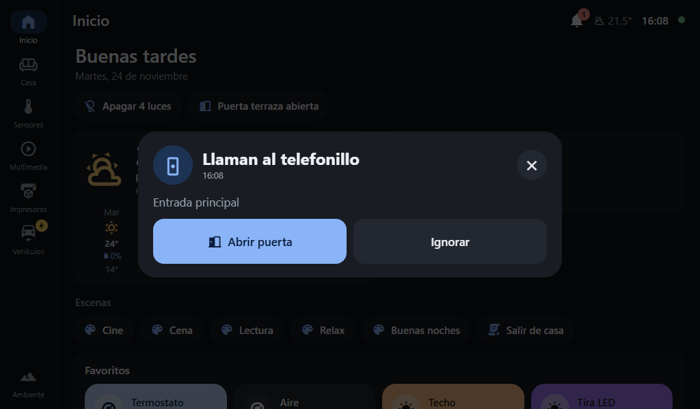
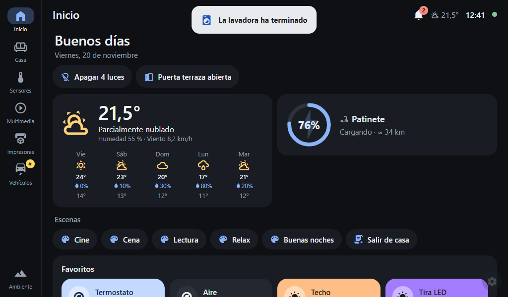

# Avisos en el panel desde Home Assistant

Cualquier automatización de Home Assistant puede mostrar un aviso en el panel lanzando el evento `panel_notification`. El aviso puede llevar **botones que ejecutan acciones** de Home Assistant, por ejemplo abrir la puerta del telefonillo.

## Cómo se ve cada nivel

<p align="center">
   
</p>

| `level` | En el panel | Sonido | Se cierra solo |
|---|---|---|---|
| `info` | Banner arriba; no interrumpe | Un pitido corto | A los 10 s |
| `warning` | Ventana en el centro. Saca el panel del modo ambiente y quita el modo noche | "Ding-dong" cada 6 s durante 30 s | A los 120 s |
| `critical` | Pantalla en rojo parpadeando | Pitido continuo hasta cerrarlo | No: hay que tocarlo |

Mientras hay un aviso abierto, el panel no pasa al modo ambiente y la pantalla no se oscurece. Los últimos 30 avisos quedan en el **panel de acceso rápido**, ventana **Avisos** (desliza desde arriba o toca la campana de la barra superior): tocar uno lo vuelve a abrir con sus botones y la × lo quita.

## Datos del evento

```yaml
- event: panel_notification
  event_data:
    id: telefonillo            # opcional. Si llega otro con el mismo id, sustituye al anterior
    title: Llaman al telefonillo
    message: Entrada principal # opcional
    level: warning             # info | warning | critical
    icon: mdi:doorbell         # cualquier icono mdi:
    image: camera.entrada      # opcional: una cámara (se refresca cada 2 s), una entidad image.* o una URL
    timeout: 60                # opcional: segundos hasta cerrarse solo (0 = hasta que lo toques)
    sound: true                # opcional
    actions:                   # opcional: botones (si no pones ninguno sale "Entendido")
      - title: Abrir puerta
        icon: mdi:door-open
        service: button.press               # cualquier acción de HA: dominio.servicio
        entity_id: button.entrada_principal_abrir_puerta
        data: {}                            # opcional: datos del servicio
        confirm: false                      # true = pide un segundo toque
        style: primary                      # primary | danger (el primero es primary por defecto)
      - title: Ignorar                      # sin service: solo cierra el aviso
```

- **Cerrar un aviso desde Home Assistant:** `event: panel_notification_close` con `event_data: { id: telefonillo }`.
- **Saber qué botón se pulsó:** el panel lanza `panel_notification_action` con `{ id, action }` (`action` es el `title` del botón). Puedes usarlo como disparador o con `wait_for_trigger` en tus automatizaciones.

## Telefonillo Ring: abrir la puerta desde el panel

Pega esto en **Ajustes → Automatizaciones → Crear → ⋮ → Editar en YAML**:

```yaml
alias: "Panel: llaman al telefonillo"
description: Aviso en el panel con botón para abrir la puerta del portal
triggers:
  - trigger: state
    entity_id: event.entrada_principal_timbre
    not_from: unavailable
actions:
  - event: panel_notification
    event_data:
      id: telefonillo
      title: Llaman al telefonillo
      message: Entrada principal
      level: warning
      icon: mdi:doorbell
      timeout: 60
      actions:
        - title: Abrir puerta
          icon: mdi:door-open
          service: button.press
          entity_id: button.entrada_principal_abrir_puerta
        - title: Ignorar
          icon: mdi:close
mode: single
```

Para que el aviso desaparezca si abres desde la app de Ring o desde el propio telefonillo:

```yaml
alias: "Panel: cerrar aviso del telefonillo"
triggers:
  - trigger: state
    entity_id: event.entrada_principal_desbloqueo_del_intercomunicador
    not_from: unavailable
actions:
  - event: panel_notification_close
    event_data:
      id: telefonillo
mode: single
```

## Más ideas

**Patinete cargado** (aviso informativo):

```yaml
triggers:
  - trigger: state
    entity_id: binary_sensor.mi_patinete_cargado
    to: "on"
actions:
  - event: panel_notification
    event_data:
      title: Patinete cargado
      message: "{{ states('sensor.mi_patinete_bateria') }} % de batería"
      level: info
      icon: mdi:scooter
```

**Puerta abierta más de 10 minutos**, con un botón que te avisa al móvil si no estás en casa:

```yaml
triggers:
  - trigger: state
    entity_id: binary_sensor.ikea_door_sensor_kitchen_contact
    to: "on"
    for: "00:10:00"
actions:
  - event: panel_notification
    event_data:
      id: puerta_cocina
      title: La puerta de la cocina lleva 10 min abierta
      level: warning
      icon: mdi:door-open
      actions:
        - title: Avisar al móvil
          icon: mdi:cellphone-message
          service: notify.mobile_app_mi_movil
          data:
            message: La puerta de la cocina sigue abierta
        - title: Vale
```

**Algo grave** (crítico: pantalla en rojo y pitido hasta que lo cierres):

```yaml
actions:
  - event: panel_notification
    event_data:
      title: ¡Fuga de agua!
      message: Sensor bajo el fregadero
      level: critical
      icon: mdi:water-alert
```

## Notas

- En la Pi el sonido suena sin tocar antes la pantalla, gracias a una opción que pone `scripts/setup-kiosk.sh` en Chromium. La Pi necesita un altavoz, ya sea por el jack o por HDMI si tu pantalla tiene.
- Los botones ejecutan lo que diga la automatización con el token del panel. Pon solo acciones que te parezca bien que cualquiera delante de la pantalla pueda pulsar. Para las delicadas usa `confirm: true`.
