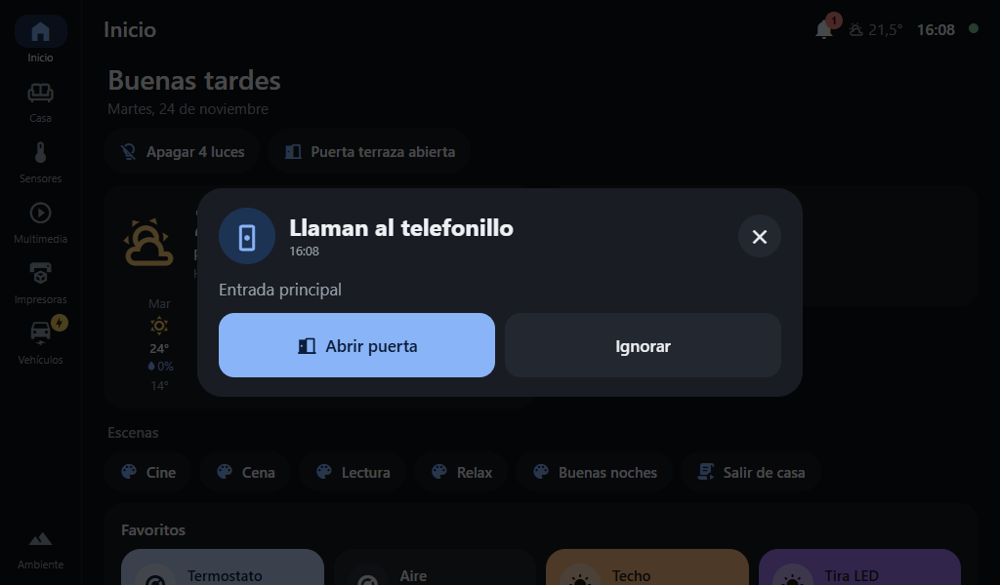
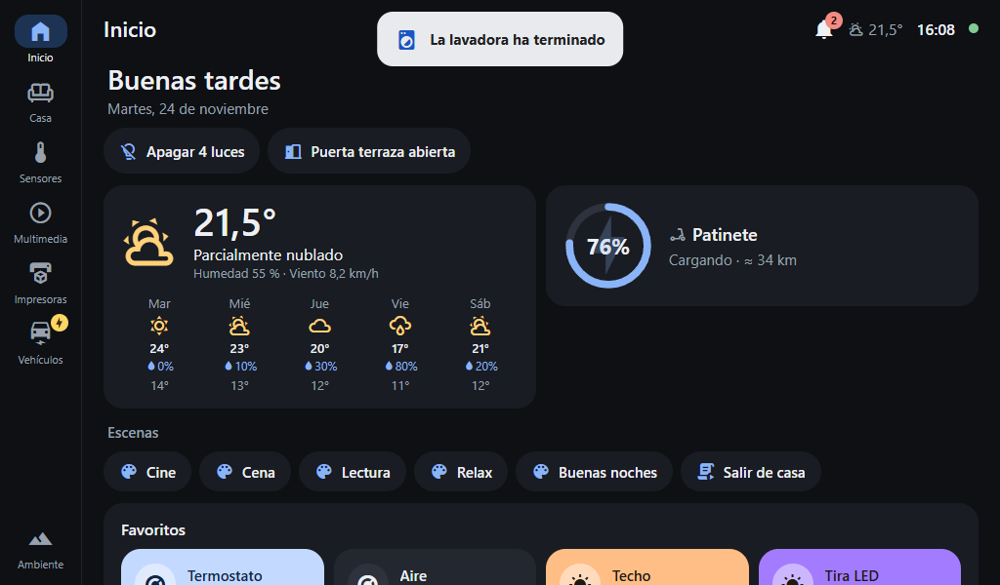

# Notifications on the panel from Home Assistant

Any Home Assistant automation can show a notification on the panel by firing the `panel_notification` event. The notification can have **buttons that run Home Assistant actions**, for example opening the door from the intercom.

## How each level looks

<p align="center">
   
</p>

| `level` | On the panel | Sound | Closes by itself |
|---|---|---|---|
| `info` | Banner at the top; it does not interrupt | A short beep | After 10 s |
| `warning` | Window in the centre. It takes the panel out of ambient mode and turns off night mode | "Ding-dong" every 6 s for 30 s | After 120 s |
| `critical` | Flashing red screen | Continuous beep until you close it | No: you have to tap it |

While a notification is open, the panel does not go to ambient mode and the screen does not dim. The last 30 notifications stay in the **quick access panel**, **Notifications** window (swipe down from the top or tap the bell on the top bar): tapping one opens it again with its buttons and the × removes it.

## Event data

```yaml
- event: panel_notification
  event_data:
    id: intercom               # optional. If another one arrives with the same id, it replaces the previous one
    title: Someone is at the door
    message: Main entrance     # optional
    level: warning             # info | warning | critical
    icon: mdi:doorbell         # any mdi: icon
    image: camera.entrance     # optional: a camera (refreshes every 2 s), an image.* entity or a URL
    timeout: 60                # optional: seconds until it closes by itself (0 = until you tap it)
    sound: true                # optional
    actions:                   # optional: buttons (with none, "OK" shows)
      - title: Open the door
        icon: mdi:door-open
        service: button.press               # any HA action: domain.service
        entity_id: button.main_entrance_open_door
        data: {}                            # optional: service data
        confirm: false                      # true = asks for a second tap
        style: primary                      # primary | danger (the first one is primary by default)
      - title: Ignore                       # no service: it only closes the notification
```

- **Close a notification from Home Assistant:** `event: panel_notification_close` with `event_data: { id: intercom }`.
- **Know which button was pressed:** the panel fires `panel_notification_action` with `{ id, action }` (`action` is the button's `title`). You can use it as a trigger or with `wait_for_trigger` in your automations.

## Ring intercom: open the door from the panel

Paste this in **Settings → Automations → Create → ⋮ → Edit in YAML**:

```yaml
alias: "Panel: someone is at the door"
description: Notification on the panel with a button to open the street door
triggers:
  - trigger: state
    entity_id: event.main_entrance_ding
    not_from: unavailable
actions:
  - event: panel_notification
    event_data:
      id: intercom
      title: Someone is at the door
      message: Main entrance
      level: warning
      icon: mdi:doorbell
      timeout: 60
      actions:
        - title: Open the door
          icon: mdi:door-open
          service: button.press
          entity_id: button.main_entrance_open_door
        - title: Ignore
          icon: mdi:close
mode: single
```

So the notification goes away if you open from the Ring app or from the intercom itself:

```yaml
alias: "Panel: close the intercom notification"
triggers:
  - trigger: state
    entity_id: event.main_entrance_intercom_unlock
    not_from: unavailable
actions:
  - event: panel_notification_close
    event_data:
      id: intercom
mode: single
```

## More ideas

**Scooter charged** (info notification):

```yaml
triggers:
  - trigger: state
    entity_id: binary_sensor.my_scooter_charged
    to: "on"
actions:
  - event: panel_notification
    event_data:
      title: Scooter charged
      message: "{{ states('sensor.my_scooter_battery') }} % battery"
      level: info
      icon: mdi:scooter
```

**Door open for more than 10 minutes**, with a button that tells your phone if you are not home:

```yaml
triggers:
  - trigger: state
    entity_id: binary_sensor.kitchen_door_contact
    to: "on"
    for: "00:10:00"
actions:
  - event: panel_notification
    event_data:
      id: kitchen_door
      title: The kitchen door has been open for 10 min
      level: warning
      icon: mdi:door-open
      actions:
        - title: Tell my phone
          icon: mdi:cellphone-message
          service: notify.mobile_app_my_phone
          data:
            message: The kitchen door is still open
        - title: OK
```

**Something serious** (critical: red screen and beeping until you close it):

```yaml
actions:
  - event: panel_notification
    event_data:
      title: Water leak!
      message: Sensor under the sink
      level: critical
      icon: mdi:water-alert
```

## Notes

- On the Pi the sound plays without touching the screen first, thanks to an option `scripts/setup-kiosk.sh` sets in Chromium. The Pi needs a speaker, through the jack or through HDMI if your screen has one.
- The buttons run whatever the automation says with the panel's token. Only add actions you are happy for anyone in front of the screen to press. For sensitive ones use `confirm: true`.
