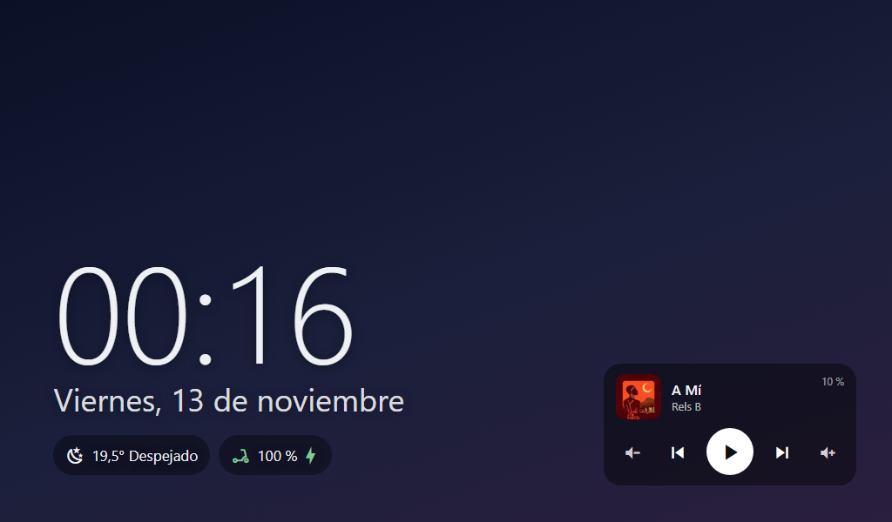
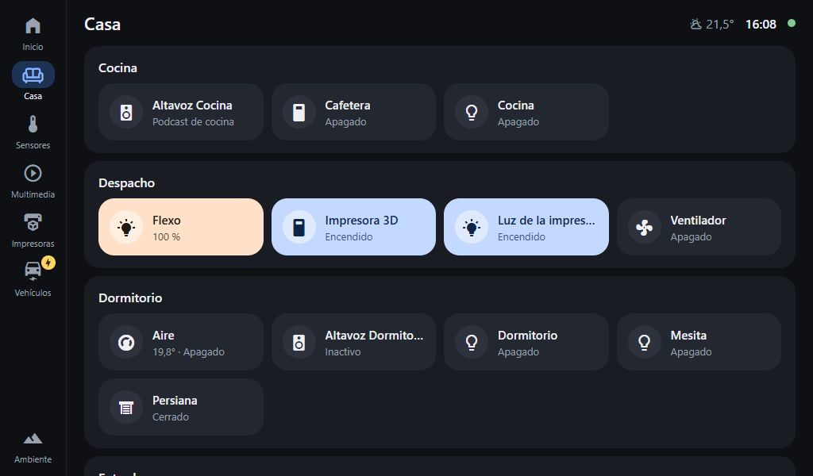
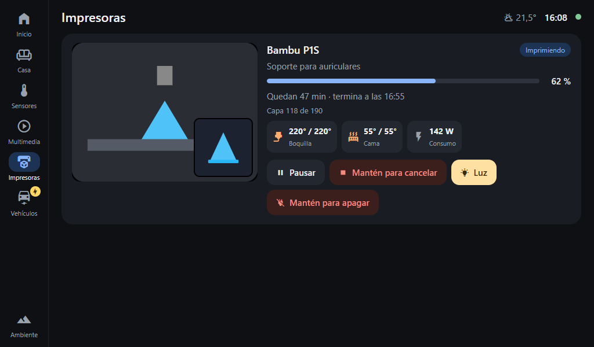
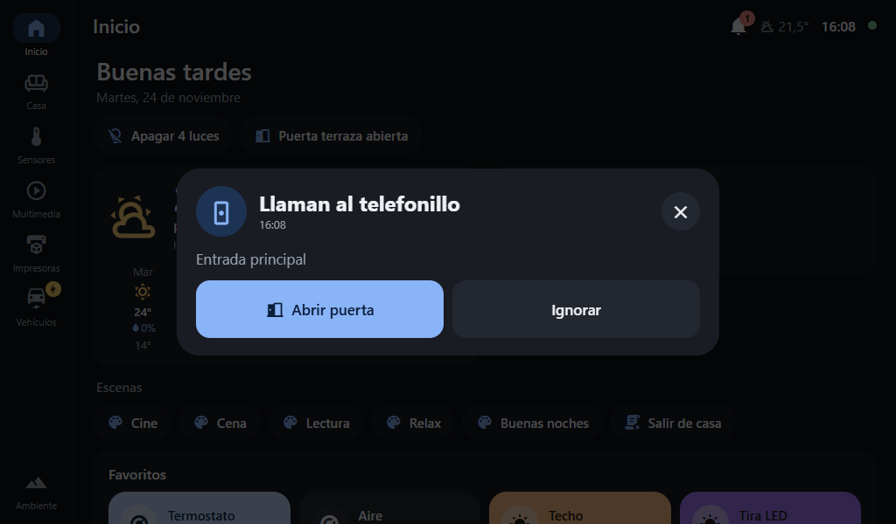

# Panel Hogar

Pantalla táctil para casa, al estilo Google Nest Hub, que se conecta a **Home Assistant**. Se monta con una Raspberry Pi y una pantalla, y sirve para ver y controlar la casa de un vistazo. Cuando nadie la toca, se convierte en un reloj con fotos.

<p align="center">
   
</p>

## Qué puedes hacer

- **Inicio**: el tiempo, un resumen (luces encendidas, puertas abiertas), el patinete, las impresoras que están imprimiendo, las escenas y los favoritos.
- **Casa**: encender y apagar luces (cada una con su color), enchufes, persianas, el clima, cerraduras, el aspirador (eligiendo habitaciones) y la TV o los altavoces.
- **Sensores**: temperatura, humedad y demás por habitación, con gráfica de las últimas 24 h.
- **Multimedia**: controlar la música y ver las cámaras.
- **Impresoras 3D**: progreso, cámara, temperaturas y su enchufe.
- **Patinete**: batería, carga y ajustes.
- **Modo ambiente**: reloj, fotos de tus álbumes (Immich, Google Fotos…), burbujas con lo importante y un mini reproductor.
- **Alarmas y avisos**: alarmas de despertador, y avisos que lanzas desde Home Assistant con botones. Por ejemplo, «llaman al telefonillo → Abrir puerta» ([cómo](AVISOS.md)).
- **A tu medida**: cada pestaña es una rejilla de componentes (botones, información, tarjetas, tiempo, reproductor, impresora…) que colocas arrastrando desde la web, con su ancho, sus ajustes y condiciones para aparecer o no. Los componentes y las burbujas son pequeños scripts con HTML y CSS que puedes cambiar, crear o importar ([cómo](SCRIPTS.md)).
- **Configurarlo desde el móvil**: escanea el QR de la pantalla y cambia todo desde una web con contraseña.

<p align="center">
    
   
</p>

**Avisos desde Home Assistant**: con botones que hacen cosas, o un aviso discreto arriba.

<p align="center">
   
</p>

## Qué necesitas

- Una Raspberry Pi 3, 4 o 5 (recomendada la Pi 4) con Raspberry Pi OS Lite (sin escritorio).
- Una pantalla táctil (HDMI o de las que van en los pines).
- Home Assistant y un **token de acceso**: en HA, tu perfil → Seguridad → Tokens de larga duración.

## Montarlo

1. Instala Raspberry Pi OS Lite en la tarjeta, con WiFi y SSH activados.
2. Entra por SSH y ejecuta:
   ```bash
   git clone https://github.com/adrisg/ha-panel ~/ha-panel
   bash ~/ha-panel/install.sh
   ```
   Te pide una contraseña para la web de configuración, si quieres el **altavoz** de Music Assistant y si reiniciar al acabar.
   (Por partes: `setup-kiosk.sh` instala el panel y `setup-sendspin.sh` el altavoz.)
3. Al arrancar, la pantalla muestra un **QR**. Escanéalo con el móvil, entra con la contraseña y pon la dirección de tu Home Assistant y el token.
4. ¡Listo! El panel se recarga solo cada vez que guardas cambios.

## Ajustes

Se cambian en el botón ⚙ de la pantalla o desde la web del móvil:

| | |
|---|---|
| **Pantalla** | brillo, cuándo pasa a modo ambiente, cuándo se apaga |
| **Modo noche** | horario, brillo bajo o pantalla apagada |
| **Fotos** | álbumes, cada cuánto cambian, cómo se ven (rellenar / entera con fondo difuminado / entera) |
| **Modo ambiente** | qué burbujas salen y en qué orden, altavoz por defecto |
| **Avisos y alarmas** | sonido, volumen, alarmas con hora y días |
| **Qué se ve** | favoritos, ocultar dispositivos, enchufes de las impresoras |
| **Red** | WiFi, IP y nombre del panel |
| **Altavoz** | la Pi suena como altavoz de Music Assistant (Sendspin): nombre y salida (jack, HDMI, USB) |
| **Actualizaciones** | busca versión nueva cada 3 h: te avisa (botón «Actualizar») o se actualiza sola cada día a la hora que elijas |

**Altavoz (opcional):** si no lo instalaste con `install.sh`, hazlo con `bash ~/ha-panel/setup-sendspin.sh` y actívalo en la web → Ajustes → Altavoz. Sale en Music Assistant como un reproductor más.

## Probarlo en el ordenador

Con Python instalado: `python dev.py`. Se abre el panel en el navegador; la web de configuración está en `http://127.0.0.1:8080` (contraseña `panel`).
