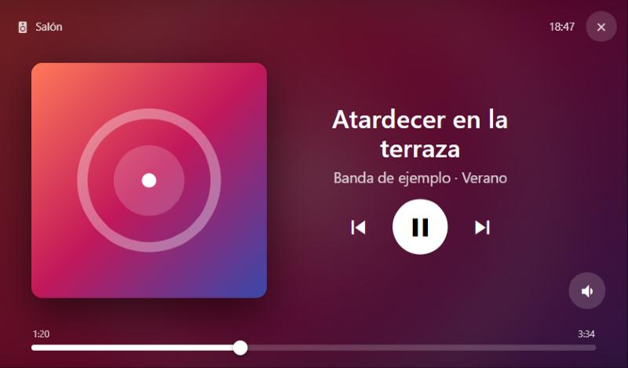
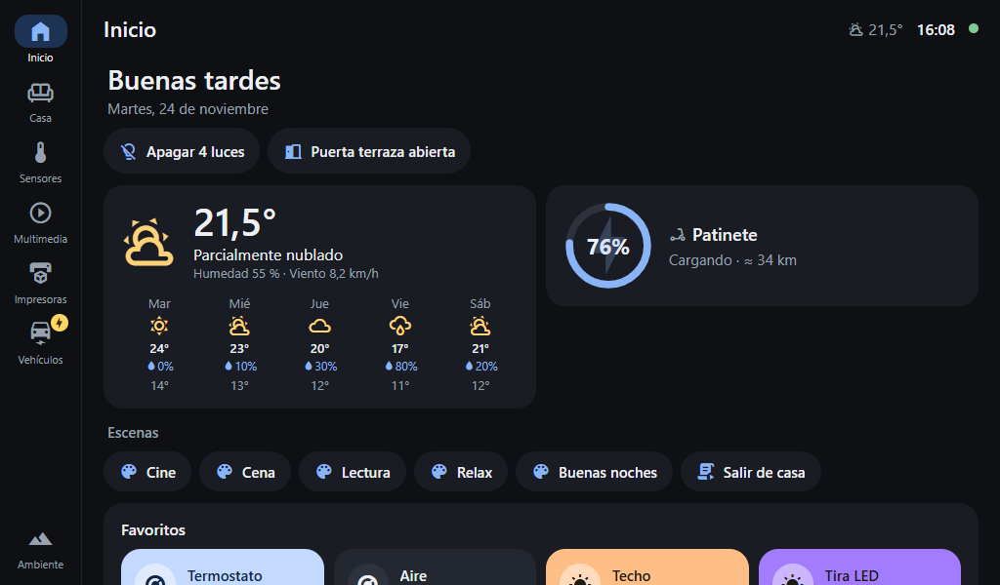
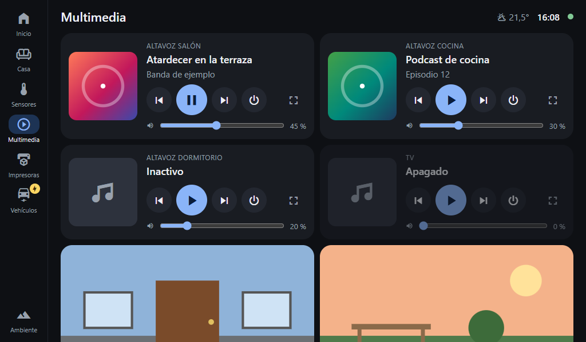
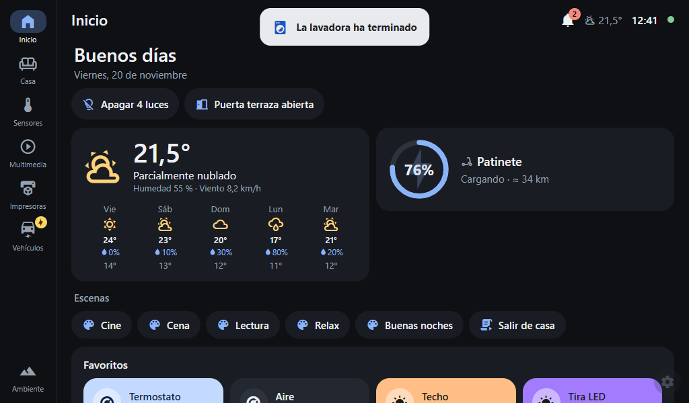

# Panel Hogar

### Crea tu propio Google Nest Hub o Amazon Echo Show

Una pantalla bonita para el escritorio que decora con tus fotos y desde la que ves y manejas toda tu casa. **100 % local**: habla directamente con tu **Home Assistant**, sin cuentas, sin suscripciones y sin nubes de nadie. Tú la montas con una Raspberry Pi.

<p align="center">
   
</p>

## ✨ Lo que la hace especial

- 🖼️ **Decora con tus fotos** mientras ves lo importante: la hora, el tiempo, la música… Fotos de **Immich**, **Google Fotos**, una carpeta de **Home Assistant** o enlaces.
- 🔊 **También es un altavoz** de Music Assistant, con la carátula a pantalla completa.
- 🔔 **Avisos con botones**: «llaman al telefonillo → Abrir puerta» ([cómo](AVISOS.md)).
- 🫧 **Burbujas**: lo importante de un vistazo (luces encendidas, el patinete cargando, la impresora…). Puedes crear las tuyas ([cómo](SCRIPTS.md)).
- 🧩 **Pestañas a tu gusto**, con componentes que puedes crear tú ([cómo](SCRIPTS.md#componentes)).

## Qué puedes controlar

<p align="center">
   
</p>

- **Inicio**: el tiempo, un resumen (luces encendidas, puertas abiertas), escenas, favoritos y lo que esté pasando (patinete cargando, impresora imprimiendo…).
- **Casa**: luces (con su color), enchufes, persianas, clima, cerraduras, el aspirador (eligiendo habitaciones), la TV y los altavoces.
- **Sensores**: temperatura, humedad y demás por habitación, con gráfica de las últimas 24 h.
- **Multimedia**: la música de todos los altavoces y las cámaras.
- **Impresoras 3D**: progreso, cámara, temperaturas y su enchufe.
- **Patinete**: batería, autonomía, carga y ajustes.

<p align="center">
    
</p>

**Avisos desde Home Assistant**: con botones que hacen cosas, o un aviso discreto arriba.

<p align="center">
   
</p>

## Qué necesitas

| | |
|---|---|
| **Raspberry Pi 4** (2 GB o más) | también vale una Pi 3 o 5 |
| **Pantalla táctil HDMI de 7″, 1024×600, con táctil por USB** | se conecta con un cable HDMI (la Pi 4 tiene micro-HDMI) y un USB para el táctil |
| **Fuente oficial de la Pi 4** (5,1 V, 3 A, USB-C) | con un cargador de móvil se queda corta y se cuelga |
| **Tarjeta microSD** de 16 GB o más | con Raspberry Pi OS Lite (sin escritorio) |
| **Home Assistant** | y un token: tu perfil → Seguridad → Tokens de larga duración |
| Opcional: **Music Assistant** | para usar la Pi como altavoz (por el jack, HDMI o USB) |

**Otras pantallas:**
- ✅ **Por cinta DSI** (el conector plano «DISPLAY» de la Pi), como la **Raspberry Pi Touch Display** oficial de 7″ o la **Touch Display 2**: deberían ir bien y con brillo real, pero no están probadas. La Touch Display 2 es vertical: gírala con `ROTATE` en `~/kiosk-browser.sh`.
- ❌ **Por los pines GPIO (SPI)**, como las Waveshare de 3,5″ (480×320): no valen. Son muy lentas para el panel y necesitan controladores especiales.

## Montarlo

1. Instala Raspberry Pi OS Lite en la tarjeta, con WiFi y SSH activados.
2. Entra por SSH y ejecuta:
   ```bash
   git clone https://github.com/adrisg/ha-panel ~/ha-panel
   bash ~/ha-panel/install.sh
   ```
   Te pide una contraseña para la web de configuración, si quieres el **altavoz** de Music Assistant y si reiniciar al acabar.
   (Por partes: `setup-kiosk.sh` instala el panel y `setup-sendspin.sh` el altavoz.)
3. Al arrancar, la pantalla muestra un **QR**. Escanéalo con el móvil, entra con la contraseña y pon la dirección de tu Home Assistant y el token.
4. ¡Listo! El panel se recarga solo cada vez que guardas cambios.

## Ajustes

Se cambian en el botón ⚙ de la pantalla o desde la web del móvil:

<p align="center"></p>

| | |
|---|---|
| **Pantalla** | brillo, cuándo pasa a modo ambiente, cuándo se apaga |
| **Modo noche** | horario, brillo bajo o pantalla apagada |
| **Fotos** | álbumes, cada cuánto cambian y cómo se ven |
| **Modo ambiente** | qué burbujas salen y en qué orden, altavoz por defecto |
| **Avisos y alarmas** | sonido, volumen, alarmas con hora y días |
| **Qué se ve** | favoritos, ocultar dispositivos, enchufes de las impresoras |
| **Red** | WiFi, IP y nombre del panel |
| **Altavoz** | nombre, salida de audio y qué altavoces abren «Sonando» |
| **Actualizaciones** | avisar o actualizar sola a una hora |

**Altavoz:** si no lo instalaste con `install.sh`, lanza `bash ~/ha-panel/setup-sendspin.sh` y actívalo en la web → Ajustes → Altavoz.

## Probarlo en el ordenador

Con Python instalado: `python dev.py`. El panel se abre en el navegador y la web de configuración está en `http://127.0.0.1:8080` (contraseña `panel`).

## Documentación

- [Burbujas y componentes](SCRIPTS.md): cómo funcionan, cómo crear los tuyos y ejemplos.
- [Avisos](AVISOS.md): cómo lanzarlos desde Home Assistant, con botones.
