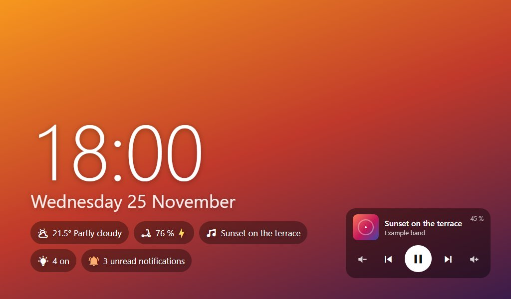
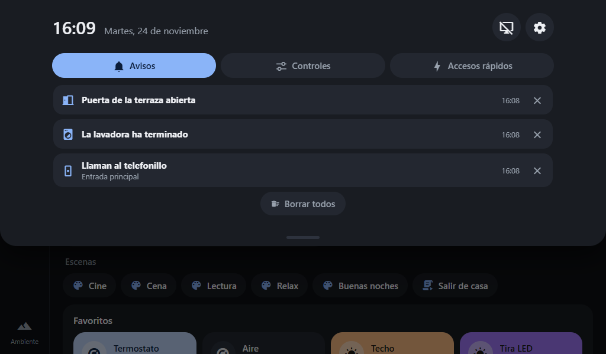
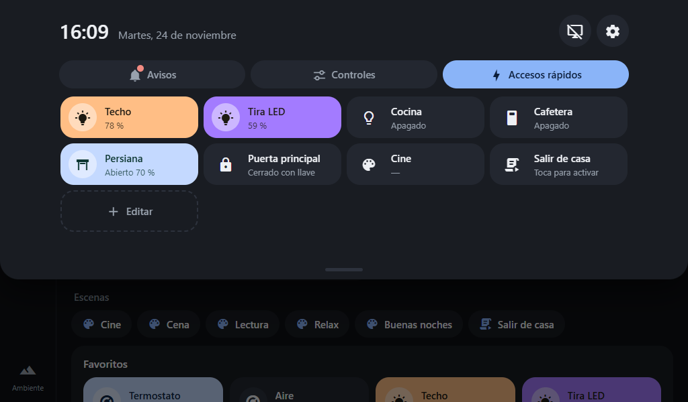
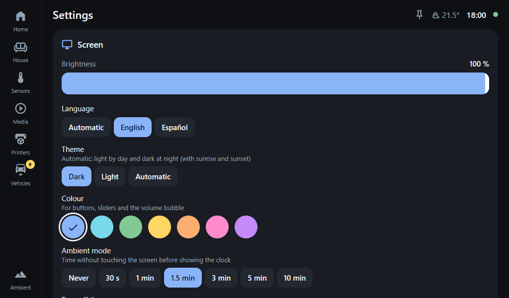

# Panel Hogar

### Crea tu propio Google Nest Hub o Amazon Echo Show

Una pantalla bonita para el escritorio que decora con tus fotos y desde la que ves y manejas toda tu casa. **100 % local**: habla directamente con tu **Home Assistant**, sin cuentas, sin suscripciones y sin nubes de nadie. Tú la montas con una Raspberry Pi.

<p align="center">
   
</p>

## ✨ Lo que la hace especial

- 🖼️ **Decora con tus fotos** mientras ves lo importante: la hora, el tiempo, la música… Fotos de **Immich**, **Google Fotos**, una carpeta de **Home Assistant** o enlaces.
- 🔊 **También es un altavoz** de Music Assistant, con la carátula a pantalla completa.
- 🔔 **Avisos con botones**: «llaman al telefonillo → Abrir puerta» ([cómo](AVISOS.md)).
- 🫧 **Toda la información de un solo golpe**: burbujas en la pantalla de inicio y en el modo ambiente con el tiempo, las luces encendidas, el coche cargando, la impresora… Eliges cuáles salen y en qué orden, y puedes crear las tuyas ([cómo configurarlas](SCRIPTS.md)).
- 🧩 **Pestañas a tu gusto**, con componentes que puedes crear tú ([cómo](SCRIPTS.md#componentes)).
- ⬇️ **Panel de acceso rápido como en Android**: desliza desde arriba para la música, el volumen, el brillo, los avisos y tus accesos rápidos.
- 🎨 **Totalmente configurable a tu gusto**: el aspecto, qué sale en cada pantalla y cómo se comporta.
- 🌍 **En español o en inglés** (o el idioma de tu Home Assistant, automáticamente).

## Qué puedes controlar

<p align="center">
   
</p>

- **Inicio**: el tiempo, un resumen (luces encendidas, puertas abiertas), escenas, favoritos y lo que esté pasando (vehículo cargando, impresora imprimiendo…).
- **Casa**: luces (con su color), enchufes, persianas, clima, cerraduras, el aspirador (eligiendo habitaciones), la TV y los altavoces.
- **Sensores**: temperatura, humedad y demás por habitación, con gráfica de las últimas 24 h.
- **Multimedia**: la música de todos los altavoces y las cámaras.
- **Impresoras 3D**: progreso, cámara, temperaturas y su enchufe.
- **Vehículos**: coche, moto o patinete eléctrico: batería, autonomía, carga y ajustes.

<p align="center">
    
</p>

**Avisos desde Home Assistant**: con botones que hacen cosas, o un aviso discreto arriba.

<p align="center">
   
</p>

## Panel de acceso rápido

Desliza hacia abajo desde el borde de arriba, en cualquier pantalla (también en el modo ambiente y en «Sonando»). Tiene tres ventanas que se cambian deslizando de lado o con sus pestañas:

<p align="center">
    
</p>

| ← Avisos | Controles (sale al abrir) | Accesos rápidos → |
|---|---|---|
| Los últimos avisos. Tocar uno lo vuelve a abrir; la × lo quita. Un puntito en la campana marca los que no has visto. | Hora, apagar la pantalla, ⚙ Ajustes, la música que suena y las barras de volumen, avisos y brillo. | Luces, enchufes, escenas… los que elijas («Editar»). Un toque los enciende o apaga; mantener abre su detalle. |

La campana de la barra de arriba abre el panel de acceso rápido directamente en los avisos. Se cierra deslizando hacia arriba o tocando fuera.

**Volumen:** si cambias el volumen del panel desde Home Assistant o Music Assistant, sale arriba una burbuja con el número. En «Sonando», si lo que suena es **otro** altavoz, abajo a la derecha tienes un botón con su volumen.

## Qué necesitas

| | |
|---|---|
| **Raspberry Pi 4** (2 GB o más) | también vale una Pi 3 o 5 |
| **Pantalla táctil HDMI de 7″, 1024×600, con táctil por USB** | se conecta con un cable HDMI (la Pi 4 tiene micro-HDMI) y un USB para el táctil |
| **Fuente oficial de la Pi 4** (5,1 V, 3 A, USB-C) | con un cargador de móvil se queda corta y se cuelga |
| **Tarjeta microSD** de 16 GB o más | con Raspberry Pi OS Lite (sin escritorio) |
| **Home Assistant** | y un token: tu perfil → Seguridad → Tokens de larga duración |
| Opcional: **Music Assistant** | para usar la Pi como altavoz (por el jack, HDMI o USB) |

**Otras pantallas:**
- ✅ **Por cinta DSI** (el conector plano «DISPLAY» de la Pi), como la **Raspberry Pi Touch Display** oficial de 7″ o la **Touch Display 2**: deberían ir bien y con brillo real, pero no están probadas. La Touch Display 2 es vertical: gírala con `ROTATE` en `~/kiosk-browser.sh`.
- ❌ **Por los pines GPIO (SPI)**, como las Waveshare de 3,5″ (480×320): no valen. Son muy lentas para el panel y necesitan controladores especiales.

## Montarlo

1. Instala Raspberry Pi OS Lite en la tarjeta, con WiFi y SSH activados.
2. Entra por SSH y ejecuta:
   ```bash
   git clone https://github.com/adrisg/ha-panel ~/ha-panel
   bash ~/ha-panel/install.sh
   ```
   Te pide una contraseña para la web de configuración, si quieres el **altavoz** de Music Assistant y si reiniciar al acabar.
   (Por partes, en `scripts/`: `setup-kiosk.sh` instala el panel, `setup-sendspin.sh` el altavoz y `setup-voz.sh` el asistente de voz.)
3. Al arrancar, la pantalla muestra un **QR**. Escanéalo con el móvil, entra con la contraseña y pon la dirección de tu Home Assistant y el token.
4. ¡Listo! Todo se guarda con el botón **Guardar**. El panel aplica los ajustes al momento; solo se recarga si cambias la conexión, las entidades, las fotos o el código.

## Ajustes

En la pantalla: panel de acceso rápido → ⚙. Desde el móvil: la web de configuración (el QR del arranque), ordenada en pestañas:

<p align="center"></p>

| Pestaña de la web | Qué hay |
|---|---|
| 🏠 **General** | mando a distancia, Home Assistant, favoritos y entidades ocultas, accesos rápidos |
| 🖥️ **Pantalla** | brillo, aspecto, cuándo pasa a modo ambiente y cuándo se apaga, modo noche |
| 🖼️ **Modo ambiente** | altavoces por prioridad, fotos (álbumes, cada cuánto cambian, cómo se ven) y burbujas |
| 🔊 **Sonido** | por dónde suena la Pi y su volumen (el límite), música, avisos y alarmas, altavoz de Music Assistant, «Sonando» y voz en la pantalla |
| 🗂️ **Pestañas** | las pestañas del panel y qué lleva cada una |
| 🧩 **Componentes** | crear y editar componentes |
| 🛠️ **Sistema** | red (WiFi, IP, nombre) y actualizaciones |
| 🧪 **Beta** | lo que está en pruebas: el asistente de voz con el micro de la Pi |

Todo se guarda con **Guardar**, abajo.

**Altavoces por prioridad:** tanto el reproductor del modo ambiente como la pantalla «Sonando» usan una lista ordenada de altavoces («Este panel» incluido):
- **Modo ambiente:** sale el primero de la lista que esté sonando; si no suena ninguno, el primero en pausa y, si no, el primero.
- **«Sonando»:** se abre al empezar a sonar uno de la lista. Si ya se ve otro, cambia solo si el nuevo está más arriba o si el que se ve no suena. Al parar, pasa al siguiente que siga sonando o se cierra sola (tiempo a elegir).

**Asistente de voz (beta):** con un micro USB, `bash ~/ha-panel/scripts/setup-voz.sh` convierte la Pi en satélite de Assist («Okay Nabu»). En Home Assistant necesitas un motor de voz a texto (Speech-to-Phrase o Whisper) y añadir la Pi en la integración **Wyoming**. Se configura en la web → 🧪 Beta. Luego elígela en Ajustes → Asistente de voz (o en la web → Sonido → Voz en la pantalla) y saldrá una barra encima de la pantalla mientras escucha y contesta.

**Altavoz:** si no lo instalaste con `install.sh`, lanza `bash ~/ha-panel/scripts/setup-sendspin.sh` y actívalo en la web → Sonido → Altavoz.

## El panel en Home Assistant (MQTT)

Si tienes MQTT (por ejemplo el complemento **Mosquitto**), el panel aparece solo en Home Assistant como un dispositivo: no hay que instalar nada más. En la web → 🏠 General → **El panel en Home Assistant (MQTT)**: actívalo y pon el servidor, el usuario y la contraseña de MQTT.

| Entidad | Qué hace |
|---|---|
| Pantalla | encender, apagar y brillo |
| Brillo | el brillo de la pantalla, como control aparte |
| Volumen de salida | el volumen de la Pi (jack, USB…) |
| Volumen de la música | el del altavoz del panel en Home Assistant |
| Modo ambiente | entrar o salir |
| Último toque | cuándo se tocó la pantalla por última vez |
| Recargar | recarga el panel |

En esa misma tarjeta eliges cuáles se ven en Home Assistant.

## Pantalla en directo

En la web → 🏠 General → **📺 Pantalla en directo** → **Ver**: lo que muestra ahora mismo la pantalla de la Pi, actualizado cada segundo.

## Probarlo en el ordenador

Con Python instalado: `python dev.py`. El panel se abre en el navegador y la web de configuración está en `http://127.0.0.1:8080` (contraseña `panel`).

## Documentación

- [Burbujas y componentes](SCRIPTS.md): cómo funcionan, cómo crear los tuyos y ejemplos.
- [Avisos](AVISOS.md): cómo lanzarlos desde Home Assistant, con botones.
