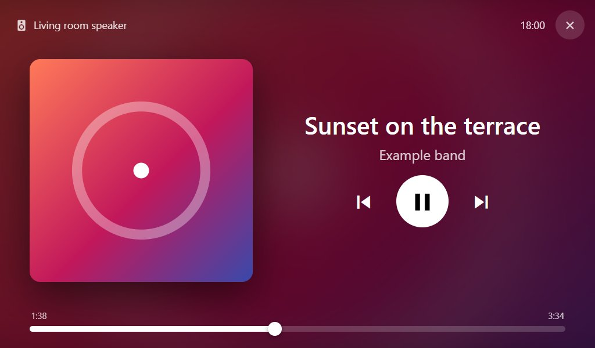
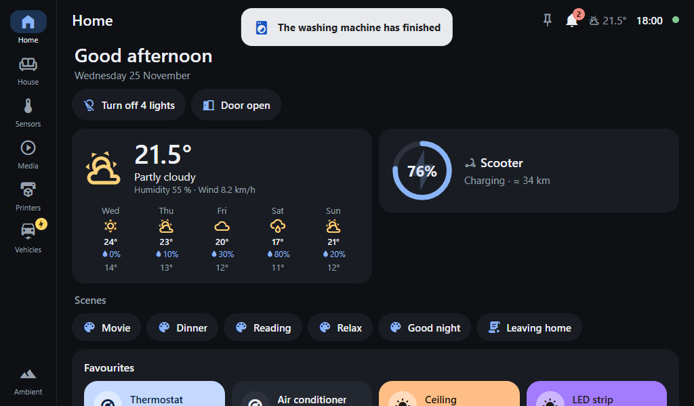
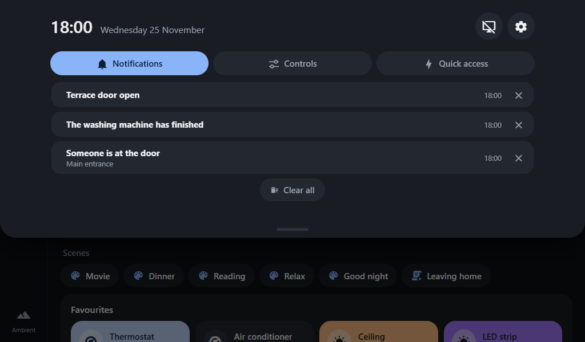
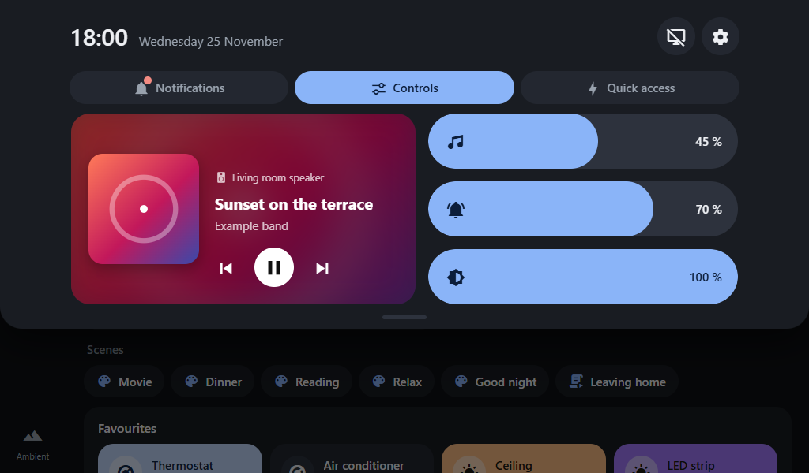

# Panel Hogar

### Build your own Google Nest Hub or Amazon Echo Show

A nice screen for your desk that shows your photos and lets you see and control your whole home. **100 % local**: it talks straight to your **Home Assistant**, with no accounts, no subscriptions and nobody's cloud. You build it with a Raspberry Pi.

<p align="center">
   
</p>

## ✨ What makes it special

- 🖼️ **Shows your photos** while you see what matters: the time, the weather, the music… Photos from **Immich**, **Google Photos**, a **Home Assistant** folder or links.
- 🔊 **It is also a speaker** for Music Assistant, with full-screen artwork.
- 🔔 **Notifications with buttons**: "someone is at the door → Open the door" ([how](NOTIFICATIONS.md)).
- 🫧 **All the information at a glance**: bubbles on the home screen and in ambient mode with the weather, the lights that are on, the car charging, the printer… You choose which ones show and in what order, and you can create your own ([how to set them up](SCRIPTS.md)).
- 🧩 **Tabs your way**, with components you can create yourself ([how](SCRIPTS.md#components)).
- ⬇️ **Quick access panel like on Android**: swipe down from the top for the music, the volume, the brightness, the notifications and your quick access.
- 🎨 **Fully configurable**: the look, what each screen shows and how it behaves.
- 🌍 **In English or Spanish** (or your Home Assistant language, automatically). Other languages are easy to add ([how](translations/README.md)).

## What you can control

<p align="center">
   
</p>

- **Home**: the weather, a summary (lights on, doors open), scenes, favourites and whatever is going on (vehicle charging, printer printing…).
- **House**: lights (with their colour), plugs, blinds, climate, locks, the vacuum (choosing rooms), the TV and the speakers.
- **Sensors**: temperature, humidity and the rest by room, with a graph of the last 24 h.
- **Media**: the music of every speaker and the cameras.
- **3D printers**: progress, camera, temperatures and their plug.
- **Vehicles**: electric car, motorbike or scooter: battery, range, charging and settings.

<p align="center">
    
</p>

**Notifications from Home Assistant**: with buttons that do things, or a discreet notice at the top.

<p align="center">
   
</p>

## Quick access panel

Swipe down from the top edge, on any screen (also in ambient mode and in "Now playing"). It has three windows you switch by swiping sideways or with their tabs:

<p align="center">
    
</p>

| ← Notifications | Controls (shown when it opens) | Quick access → |
|---|---|---|
| The latest notifications. Tapping one opens it again; the × removes it. A dot on the bell marks the unread ones. | Time, turn the screen off, ⚙ Settings, the music playing and the volume, notification and brightness bars. | Lights, plugs, scenes… the ones you choose ("Edit"). A tap turns them on or off; holding opens their details. |

The bell on the top bar opens the quick access panel straight on the notifications. Swipe up or tap outside to close it.

**Volume:** if you change the panel volume from Home Assistant or Music Assistant, a bubble with the number shows at the top. In "Now playing", if **another** speaker is playing, there is a button with its volume at the bottom right.

## What you need

| | |
|---|---|
| **Raspberry Pi 4** (2 GB or more) | a Pi 3 or 5 also works |
| **7″ HDMI touch screen, 1024×600, with USB touch** | it connects with an HDMI cable (the Pi 4 has micro-HDMI) and a USB for the touch |
| **Official Pi 4 power supply** (5.1 V, 3 A, USB-C) | a phone charger falls short and it hangs |
| **microSD card** of 16 GB or more | with Raspberry Pi OS Lite (no desktop) |
| **Home Assistant** | and a token: your profile → Security → Long-lived access tokens |
| Optional: **Music Assistant** | to use the Pi as a speaker (through the jack, HDMI or USB) |

**Other screens:**
- ✅ **DSI ribbon** (the Pi's flat "DISPLAY" connector), like the official 7″ **Raspberry Pi Touch Display** or the **Touch Display 2**: they should work well and with real brightness, but they are not tested. The Touch Display 2 is portrait: rotate it with `ROTATE` in `~/kiosk-browser.sh`.
- ❌ **GPIO pins (SPI)**, like the 3.5″ Waveshare ones (480×320): they do not work. They are too slow for the panel and need special drivers.

## Building it

1. Install Raspberry Pi OS Lite on the card, with WiFi and SSH turned on.
2. Log in over SSH and run:
   ```bash
   git clone https://github.com/adrisg/ha-panel ~/ha-panel
   bash ~/ha-panel/install.sh
   ```
   It asks for a password for the configuration web, whether you want the Music Assistant **speaker** and whether to restart at the end.
   (Step by step, in `scripts/`: `setup-kiosk.sh` installs the panel, `setup-sendspin.sh` the speaker and `setup-voice.sh` the voice assistant.)
3. At start, the screen shows a **QR**. Scan it with your phone, log in with the password and enter your Home Assistant address and the token.
4. Done! Everything is saved with the **Save** button. The panel applies the settings at once; it only reloads if you change the connection, the entities, the photos or the code.

## Settings

On the screen: quick access panel → ⚙. From the phone: the configuration web (the QR at start), organised in tabs:

<p align="center"></p>

| Web tab | What is there |
|---|---|
| 🏠 **General** | remote control, Home Assistant, favourites and hidden entities, quick access |
| 🖥️ **Screen** | brightness, look, when it goes to ambient mode and when it turns off, night mode |
| 🖼️ **Ambient mode** | speakers by priority, photos (albums, how often they change, how they look) and bubbles |
| 🔊 **Sound** | where the Pi plays and its volume (the limit), music, notifications and alarms, Music Assistant speaker, "Now playing" and voice on the screen |
| 🗂️ **Tabs** | the panel tabs and what each one has |
| 🧩 **Components** | create and edit components |
| 🛠️ **System** | network (WiFi, IP, name), updates and backup (download / restore the settings; with a password, everything encrypted, token included) |
| 🧪 **Beta** | what is being tested: the voice assistant with the Pi's mic and gestures in ambient mode (swipe ← → song or photo, ↑ ↓ volume, hold to pause) |

Everything is saved with **Save**, at the bottom.

**Speakers by priority:** both the ambient mode player and the "Now playing" screen use an ordered list of speakers ("This panel" included):
- **Ambient mode:** the first one on the list that is playing shows; if none is playing, the first paused one and, otherwise, the first one.
- **"Now playing":** it opens when one on the list starts playing. If another one is showing, it only switches if the new one is higher on the list or if the one showing is not playing. When it stops, it goes to the next one still playing or closes by itself (time of your choice).

**Voice assistant (beta):** with a USB mic, `bash ~/ha-panel/scripts/setup-voice.sh` turns the Pi into an Assist satellite ("Okay Nabu"). In Home Assistant you need a speech-to-text engine (Speech-to-Phrase or Whisper) and to add the Pi in the **Wyoming** integration. It is set up in the web → 🧪 Beta. Then choose it in Settings → Voice assistant (or in the web → Sound → Voice on the screen) and a bar shows over the screen while it listens and answers.

**Speaker:** if you did not install it with `install.sh`, run `bash ~/ha-panel/scripts/setup-sendspin.sh` and turn it on in the web → Sound → Speaker.

## The panel in Home Assistant (MQTT)

If you have MQTT (for example the **Mosquitto** add-on), the panel shows up in Home Assistant as a device by itself: nothing else to install. In the web → 🏠 General → **The panel in Home Assistant (MQTT)**: turn it on and enter the MQTT server, user and password.

| Entity | What it does |
|---|---|
| Screen | turn on, turn off and brightness |
| Brightness | the screen brightness, as a separate control |
| Output volume | the Pi's volume (jack, USB…) |
| Music volume | the panel speaker's volume in Home Assistant |
| Ambient mode | enter or leave |
| Last touched | when the screen was last touched |
| Reload | reloads the panel |

On that same card you choose which ones Home Assistant sees.

## Live screen

In the web → 🏠 General → **📺 Live screen** → **View**: what the Pi's screen shows right now, updated every second.

## Trying it on the computer

With Python installed: `python dev.py`. The panel opens in the browser and the configuration web is at `http://127.0.0.1:8080` (password `panel`).

## Documentation

- [Bubbles and components](SCRIPTS.md): how they work, how to create your own and examples.
- [Notifications](NOTIFICATIONS.md): how to send them from Home Assistant, with buttons.
- [Translations](translations/README.md): how the texts are translated and how to add a language.
