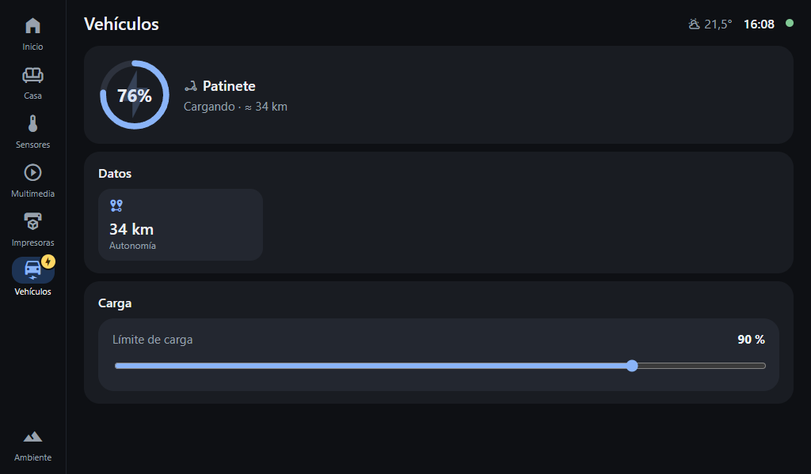

# Panel Hogar

**Convierte una Raspberry Pi y una pantalla táctil en el centro de control de tu casa.**
Se conecta a **Home Assistant**, se ve como un Google Nest Hub y, cuando nadie la toca, se transforma en un reloj con tus fotos. Además, puede sonar como un altavoz más de Music Assistant.

<p align="center">
   
</p>

## ✨ Lo que la hace especial

- 🖼️ **Modo ambiente**: un reloj grande con fotos de tus álbumes (Immich, Google Fotos…), el tiempo, burbujas con lo importante y un mini reproductor. Entra solo cuando dejas de tocarla.
- 🔊 **Es un altavoz**: la Pi aparece en Music Assistant como un reproductor más (Sendspin), sincronizado con el resto de la casa. Por el jack, HDMI o USB.
- 🎵 **Pantalla «Sonando»**: cuando empieza a sonar algo, se abre la carátula a pantalla completa con el fondo difuminado. Tiene controles, una barra que arrastras para saltar (y te enseña el tiempo mientras la mueves) y el volumen deslizable. También funciona con otros altavoces de la casa, como el de la habitación donde está el panel.
- 🔔 **Avisos con botones**: «llaman al telefonillo → Abrir puerta», «la lavadora ha terminado»… Los lanzas desde una automatización de Home Assistant y salen en grande, con sonido ([cómo](AVISOS.md)).
- ⏰ **Despertador**: alarmas con hora y días, que suenan en la propia pantalla.
- 🧩 **Hecha a tu medida**: cada pestaña es una rejilla de componentes que colocas arrastrando desde la web. Componentes y burbujas son pequeños scripts con HTML y CSS que puedes cambiar, crear o importar ([cómo](SCRIPTS.md)).
- 📱 **Se configura desde el móvil**: escaneas el QR de la pantalla y cambias todo desde una web con contraseña (Home Assistant, fotos, WiFi, IP, altavoz…).
- ⬆️ **Se actualiza sola**: busca versiones nuevas en GitHub y te avisa o se actualiza de madrugada. Sin reiniciar la pantalla si no hace falta.
- 🌙 **Cuida la pantalla**: modo noche, brillo real y apagado cuando no la usas. Se enciende al tocarla, cuando llega un aviso o cuando empieza a sonar música.
- 🔒 **No toca tu Home Assistant**: no hay que instalar integraciones ni complementos. Todo va en el navegador de la Pi, con un token de acceso.

## Qué puedes controlar

<p align="center">
   
</p>

- **Inicio**: el tiempo, un resumen (luces encendidas, puertas abiertas), escenas, favoritos y lo que esté pasando (patinete cargando, impresora imprimiendo…).
- **Casa**: luces (con su color), enchufes, persianas, clima, cerraduras, el aspirador (eligiendo habitaciones), la TV y los altavoces.
- **Sensores**: temperatura, humedad y demás por habitación, con gráfica de las últimas 24 h.
- **Multimedia**: la música de todos los altavoces y las cámaras.
- **Impresoras 3D**: progreso, cámara, temperaturas y su enchufe.
- **Patinete**: batería, autonomía, carga y ajustes.

<p align="center">
    
</p>

**Avisos desde Home Assistant**: con botones que hacen cosas, o un aviso discreto arriba.

<p align="center">
   
</p>

## Qué necesitas

- Una Raspberry Pi 3, 4 o 5 (recomendada la Pi 4) con Raspberry Pi OS Lite (sin escritorio).
- Una pantalla táctil (HDMI o de las que van en los pines).
- Home Assistant y un **token de acceso**: en HA, tu perfil → Seguridad → Tokens de larga duración.
- Opcional: Music Assistant, para usar la Pi como altavoz.

## Montarlo

1. Instala Raspberry Pi OS Lite en la tarjeta, con WiFi y SSH activados.
2. Entra por SSH y ejecuta:
   ```bash
   git clone https://github.com/adrisg/ha-panel ~/ha-panel
   bash ~/ha-panel/install.sh
   ```
   Te pide una contraseña para la web de configuración, si quieres el **altavoz** de Music Assistant y si reiniciar al acabar.
   (Por partes: `setup-kiosk.sh` instala el panel y `setup-sendspin.sh` el altavoz.)
3. Al arrancar, la pantalla muestra un **QR**. Escanéalo con el móvil, entra con la contraseña y pon la dirección de tu Home Assistant y el token.
4. ¡Listo! El panel se recarga solo cada vez que guardas cambios.

## Ajustes

Se cambian en el botón ⚙ de la pantalla o desde la web del móvil:

<p align="center"></p>

| | |
|---|---|
| **Pantalla** | brillo, cuándo pasa a modo ambiente, cuándo se apaga |
| **Modo noche** | horario, brillo bajo o pantalla apagada |
| **Fotos** | álbumes, cada cuánto cambian, cómo se ven (rellenar / entera con fondo difuminado / entera) |
| **Modo ambiente** | qué burbujas salen y en qué orden, altavoz por defecto |
| **Avisos y alarmas** | sonido, volumen, alarmas con hora y días |
| **Qué se ve** | favoritos, ocultar dispositivos, enchufes de las impresoras |
| **Red** | WiFi, IP y nombre del panel |
| **Altavoz** | nombre y salida (jack, HDMI, USB), qué altavoces abren «Sonando» y cuándo se cierra al pausar |
| **Actualizaciones** | te avisa (botón «Actualizar») o se actualiza sola cada día a la hora que elijas |

**Altavoz (opcional):** si no lo instalaste con `install.sh`, hazlo con `bash ~/ha-panel/setup-sendspin.sh` y actívalo en la web → Ajustes → Altavoz. El desfase con otros altavoces se ajusta en Music Assistant (ajustes del reproductor).

## Probarlo en el ordenador

Con Python instalado: `python dev.py`. Se abre el panel en el navegador; la web de configuración está en `http://127.0.0.1:8080` (contraseña `panel`). La pantalla y la red se simulan, así que no se cambia nada del ordenador.
